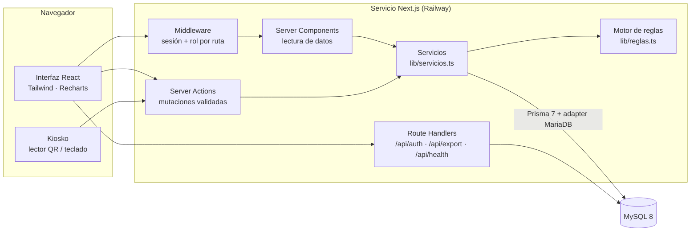
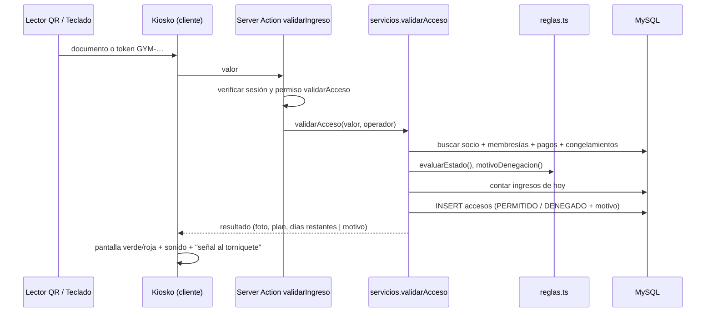
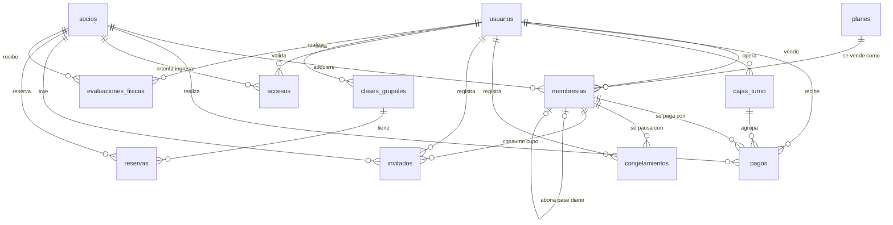

# 1. Arquitectura del sistema y diccionario de datos

## 1.1 Visión general

El sistema es una aplicación **monolítica modular** construida con **Next.js 14 (App Router)**. Un único servicio entrega la interfaz (React Server Components + componentes cliente) y la lógica de servidor (Server Actions y Route Handlers). La persistencia se hace en **MySQL 8** mediante **Prisma 7**.

### Capas

| Capa | Ubicación | Responsabilidad |
|---|---|---|
| Presentación | `src/app/**/page.tsx`, `src/components` | Vistas Bento Grid, tablas con filtros, formularios, gráficos |
| Control de acceso | `src/middleware.ts`, `src/lib/permisos.ts`, `src/lib/auth.ts` | Autenticación (NextAuth JWT), autorización por ruta y por acción |
| Aplicación | `src/acciones/*.ts` | Casos de uso: vender membresía, abonar, congelar, registrar invitado, abrir/cerrar caja, reservar… |
| Dominio | `src/lib/reglas.ts` | Reglas puras: estado del socio, motivo de denegación, horario, congelamiento, renovación |
| Infraestructura | `src/lib/prisma.ts`, `src/lib/servicios.ts`, `src/lib/metricas.ts` | Acceso a datos, sincronización de estados, agregaciones de reportes |
| Datos | `prisma/schema.prisma`, `database/schema.sql` | Modelo relacional |

### Flujo de una validación en el kiosko

### Decisiones técnicas

- **Un solo servicio en Railway:** simplifica el despliegue (una URL, un build) y evita CORS.
- **Server Actions** en lugar de una API REST para formularios: validación y permisos se ejecutan en el servidor, sin exponer endpoints innecesarios.
- **Estado del socio calculado:** el estado se recalcula con el motor de reglas cada vez que se consulta (listados, kiosko, perfil) y se guarda en `socios.estado` como caché para filtros y reportes. Así el estado nunca queda desactualizado aunque nadie lo modifique manualmente.
- **Zona horaria explícita (`APP_TIMEZONE`)**: las fechas “solo día” (vigencias, congelamientos, reservas) se guardan como `DATE`; los instantes (`accesos.fecha`, `pagos.fecha`) como `DATETIME(3)` en UTC. Los horarios de acceso se evalúan en la hora local del gimnasio.
- **Fotografías** como *data URL* JPEG 320×320 en `MEDIUMTEXT`: no requiere almacenamiento de archivos externo en Railway.
- **Inicialización idempotente** (`scripts/init-db.mjs`): crea el esquema si no existe y nunca borra datos.

---

## 1.2 Diagrama entidad-relación

---

## 1.3 Diccionario de datos

Convenciones: `PK` llave primaria, `FK` llave foránea, `UQ` único, `IDX` índice. Todas las tablas usan `utf8mb4_unicode_ci`. Los montos son `DECIMAL(12,2)` en pesos colombianos.

### `usuarios` — personal del gimnasio

| Campo | Tipo | Restricción | Descripción |
|---|---|---|---|
| id | INT | PK, AI | Identificador |
| nombre | VARCHAR(120) | NOT NULL | Nombre completo |
| email | VARCHAR(160) | UQ | Correo de inicio de sesión |
| passwordHash | VARCHAR(100) | NOT NULL | Hash bcrypt (10 rondas) |
| rol | ENUM | NOT NULL | `ADMINISTRADOR`, `RECEPCIONISTA`, `INSTRUCTOR`, `FINANZAS` |
| activo | BOOLEAN | default true | Si es false no puede iniciar sesión |
| createdAt / updatedAt | DATETIME(3) | | Auditoría |

### `planes` — catálogo y reglas de acceso

| Campo | Tipo | Descripción |
|---|---|---|
| id | INT PK | Identificador |
| codigo | VARCHAR(30) UQ | `BASE`, `PRO`, `ELITE_SEM`, `ELITE_ANUAL`, `DAY_PASS` |
| nombre, descripcion | VARCHAR / TEXT | Texto comercial |
| tipo | ENUM | `MENSUAL`, `TRIMESTRAL`, `SEMESTRAL`, `ANUAL`, `DIARIO` |
| duracionDias | INT | Días de vigencia (incluye el día de inicio) |
| precio | DECIMAL(12,2) | Precio de lista |
| invitadosMes | INT | Cupo mensual de pases de cortesía |
| evaluacionesIncluidas | INT | Evaluaciones físicas incluidas |
| valoracionMensual | BOOLEAN | Valoración física mensual (Elite) |
| lockerIncluido | BOOLEAN | Asigna locker automáticamente al vender |
| maxDiasCongelamiento | INT | Máximo de días congelables por membresía (0 = no permite) |
| accesoPreferencial | BOOLEAN | Horario extendido |
| accesosPorDia | INT | Ingresos permitidos por día (0 = ilimitado) |
| horaInicio / horaFin | VARCHAR(5) | Franja permitida `HH:MM` |
| diasPermitidos | VARCHAR(20) | Días ISO separados por coma (1 = lunes … 7 = domingo) |
| activo | BOOLEAN | Disponible para venta |

### `socios` — personas inscritas

| Campo | Tipo | Descripción |
|---|---|---|
| id | INT PK | Identificador |
| tipoDocumento | ENUM | `CC`, `TI`, `CE`, `PASAPORTE` |
| documento | VARCHAR(30) UQ | Documento de identidad (se usa en el kiosko) |
| nombres, apellidos | VARCHAR(80) | Datos personales (IDX por apellidos+nombres) |
| fechaNacimiento | DATE | Opcional |
| genero, email, direccion | VARCHAR | Opcionales |
| telefono | VARCHAR(30) | Obligatorio |
| fotoUrl | MEDIUMTEXT | Fotografía como data URL JPEG |
| contactoEmergenciaNombre / Telefono / Parentesco | VARCHAR | Contacto de emergencia |
| observacionesMedicas | TEXT | Lesiones o restricciones (visible para instructores y avisada en el kiosko) |
| qrToken | VARCHAR(64) UQ | Token `GYM-` + 24 hex codificado en el QR del carnet |
| estado | ENUM IDX | `ACTIVO`, `VENCIDO`, `CONGELADO`, `BLOQUEADO_POR_MORA` (calculado) |
| lockerNumero | INT UQ | Locker asignado (planes Elite) |

### `membresias` — venta de un plan

| Campo | Tipo | Descripción |
|---|---|---|
| id | INT PK | |
| socioId | INT FK → socios (CASCADE) | Titular |
| planId | INT FK → planes (RESTRICT) | Plan vendido |
| fechaInicio | DATE | Inicio de vigencia |
| fechaFin | DATE | Fin original = inicio + duración − 1 |
| fechaFinAjustada | DATE | Fin real = fechaFin + días congelados |
| precioLista | DECIMAL | Precio del plan al momento de la venta |
| descuento | DECIMAL | Abono del pase diario aplicado |
| montoTotal | DECIMAL | precioLista − descuento |
| diasCongelados | INT | Días acumulados de congelamiento |
| estado | ENUM | `ACTIVA`, `CANCELADA` |
| abonoDayPassId | INT FK UQ → membresias | Pase diario abonado (relación 1–1, evita doble abono) |
| vendidaPorId | INT FK → usuarios | Vendedor |
| notas | VARCHAR(255) | Observaciones |

El **saldo pendiente** se calcula como `montoTotal − SUM(pagos.monto)`; la vista `v_saldos_membresias` lo expone para consultas en Workbench.

### `congelamientos`

| Campo | Tipo | Descripción |
|---|---|---|
| id | INT PK | |
| membresiaId | INT FK → membresias (CASCADE) | Membresía pausada |
| fechaInicio / fechaFin | DATE | Rango congelado (inclusivo) |
| dias | INT | fin − inicio + 1 (se suma a `fechaFinAjustada`) |
| motivo | VARCHAR(255) | Viaje, incapacidad, etc. |
| creadoPorId | INT FK → usuarios | Quién lo registró |

### `invitados` — pases de cortesía

| Campo | Tipo | Descripción |
|---|---|---|
| id | INT PK | |
| socioId | INT FK → socios | Titular que trae al invitado |
| membresiaId | INT FK → membresias | Membresía cuyo cupo se consume |
| nombre, documento, telefono | VARCHAR | Datos del acompañante |
| fecha | DATETIME(3) | Fecha de ingreso (IDX socioId+fecha para contar cupo mensual) |
| registradoPorId | INT FK → usuarios | Recepcionista |

### `cajas_turno` — caja por turno

| Campo | Tipo | Descripción |
|---|---|---|
| id | INT PK | |
| usuarioId | INT FK → usuarios | Cajero |
| turno | ENUM | `MANANA`, `TARDE`, `NOCHE` |
| estado | ENUM | `ABIERTA`, `CERRADA` (máximo una abierta por usuario) |
| apertura / cierre | DATETIME(3) | |
| montoInicial | DECIMAL | Base en efectivo |
| totalEfectivo / totalTarjeta / totalTransferencia | DECIMAL | Totales calculados al cerrar |
| efectivoContado | DECIMAL | Arqueo físico |
| diferencia | DECIMAL | contado − (base + efectivo) — sobrante (+) o faltante (−) |
| observaciones | VARCHAR(255) | |

### `pagos`

| Campo | Tipo | Descripción |
|---|---|---|
| id | INT PK | |
| socioId | INT FK → socios | Pagador |
| membresiaId | INT FK → membresias | Membresía abonada |
| cajaId | INT FK → cajas_turno | Caja en la que ingresó el dinero |
| usuarioId | INT FK → usuarios | Cajero |
| monto | DECIMAL | Valor recibido |
| metodo | ENUM | `EFECTIVO`, `TARJETA`, `TRANSFERENCIA` |
| concepto | ENUM | `MEMBRESIA` (venta), `ABONO` (pago de saldo), `OTRO` |
| referencia, nota | VARCHAR | Voucher / número de transacción |
| fecha | DATETIME(3) IDX | Momento del pago |

### `accesos` — bitácora del torniquete

| Campo | Tipo | Descripción |
|---|---|---|
| id | INT PK | |
| socioId | INT FK → socios (NULL si no está registrado) | |
| valorIngresado | VARCHAR(80) | Documento o token leído |
| metodo | ENUM | `DOCUMENTO`, `QR` |
| tipo | ENUM | `SOCIO`, `INVITADO` |
| resultado | ENUM | `PERMITIDO`, `DENEGADO` |
| motivo | VARCHAR(255) | Motivo exacto (p. ej. *Membresía vencida el 15/10*) |
| fecha | DATETIME(3) IDX | Momento del intento |
| usuarioId | INT FK → usuarios | Operador del kiosko |

### `clases_grupales`

| Campo | Tipo | Descripción |
|---|---|---|
| id | INT PK | |
| nombre, disciplina, sala | VARCHAR | Spinning, Yoga, Crossfit, Pilates… |
| instructorId | INT FK → usuarios | Instructor |
| diaSemana | INT IDX | 1 = lunes … 7 = domingo |
| horaInicio / horaFin | VARCHAR(5) | `HH:MM` |
| aforoMax | INT | Cupo máximo por sesión |
| activa | BOOLEAN | |

### `reservas`

| Campo | Tipo | Descripción |
|---|---|---|
| id | INT PK | |
| claseId | INT FK → clases_grupales | |
| socioId | INT FK → socios | |
| fecha | DATE | Fecha concreta de la sesión |
| estado | ENUM | `CONFIRMADA`, `CANCELADA`, `ASISTIO` |
| UQ | (claseId, socioId, fecha) | Un cupo por socio por sesión |

### `evaluaciones_fisicas`

| Campo | Tipo | Descripción |
|---|---|---|
| id | INT PK | |
| socioId | INT FK → socios | |
| instructorId | INT FK → usuarios | |
| fecha | DATETIME(3) | |
| pesoKg, estaturaCm | DECIMAL(5,2) | Obligatorios (el IMC se calcula en pantalla) |
| grasaCorporal, masaMuscular | DECIMAL(5,2) | Opcionales |
| notas | TEXT | Recomendaciones |

---

## 1.4 Integridad referencial

- Borrar un **socio** elimina en cascada sus membresías, pagos, invitados, reservas y evaluaciones; sus accesos quedan con `socioId = NULL` (se conserva la bitácora).
- Un **plan** con membresías no puede eliminarse (`RESTRICT`); se desactiva con `activo = false`.
- Borrar un **usuario** deja en `NULL` las referencias de auditoría; las cajas exigen usuario (`RESTRICT`), por eso el personal se **desactiva** en lugar de borrarse.
